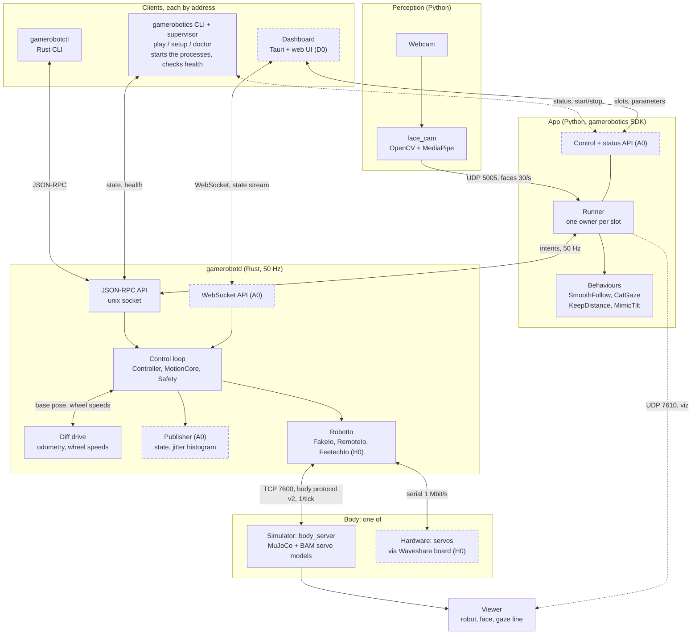

# gameRobotics architecture

Status: current as of 2026-10-22 (gamerobotics `8d3a51d`, lexjr-sim `4b57cbf`).
What the system does, feature by feature, is in [spec.md](spec.md); how an app and its
behaviours are built is in [app-architecture.md](app-architecture.md); what we're building on the
engine, and for whom, is in [product-spec.md](product-spec.md). The illustrated version, with
animations, is [architecture.html](architecture.html). All three are kept current by the
`update-docs` skill (`.claude/skills/update-docs/SKILL.md`).

## Goal

One robot daemon for every gameRobotics robot, built so a learned (RL) policy behaves on the
robot as it did in simulation. The first robot is LexJR, a six-joint desk robot with a head; three
more run on the same daemon already (a pan tilt, a two-wheeled rover, and the two combined); the next is a legged
robot. Latency and determinism decide the design: everything that closes a
control loop runs inside one 50 Hz tick, in one process, on the measurements that tick just took.

## Architecture overview

Blocks are processes and the parts inside them; arrows are how they talk. **Dashed borders are
planned, not built:** A0 (the WebSocket, status and control APIs; the publisher), D0 (the
dashboard) and H0 (the servo driver). Dashed arrows are planned links, or drawing only. Laid out
like Reachy Mini Control's own overview (github.com/pollen-robotics/reachy-mini-desktop-app).



Every client reaches the robot through an API with an address (the connection rule, below), so
the same dashboard can later point at a robot with its own Pi. A narrated video builds this diagram up step by step
(`docs/animations/ArchitectureTour.mp4`, played in architecture.html).

## The shape of it

```text
 face_cam.py ──UDP──► face_follow.py ──JSON-RPC (unix socket)──► gamerobotd ──RobotIo──► robot | simulator | fake
 (webcam,             (an app: where the face is,                (50 Hz loop,                 (TCP body protocol
  MediaPipe)           how far away)                              Safety, MotionCore)           for the simulator)
                              │                                                                       ▲
                              └──────────────── UDP, visualization only ──────────────────────────────┘
 gamerobotctl ──JSON-RPC──► gamerobotd
```

| process | repo | language | owns |
|---|---|---|---|
| `gamerobotd` | gamerobotics | Rust | the robot: the control loop, safety, motion, the hardware link |
| `gamerobotics` (`bin/`, `python/gamerobotics/play.py`) | gamerobotics | Python | nothing of the robot: starts a project's processes in order, watches their health, stops them together |
| `gamerobotctl` | gamerobotics | Rust | nothing: a command line over the API |
| `body_server.py` | lexjr-sim | Python | the robot's simulated body (LexJR, or the robot `LEXJR_ROBOT` names): MuJoCo + BAM servo models, the viewer |
| `face_cam.py` | lexjr-sim | Python | the webcam and face perception (MediaPipe); pixels never leave it; `--record` captures a face |
| `face_replay.py` | lexjr-sim | Python | the camera's stand-in: a face capture played back with its timing (`play --mocap`) |
| `recorder.py` | lexjr-sim | Python | films the simulation from the body's published state, off screen, in body time |
| `face_follow.py` | lexjr-sim | Python | a behaviour Runner: LexJR's behaviours (smooth follow or cat gaze, keep distance, mimic tilt) turn faces into intents |

## Behaviours: the app layer

```text
 Perception (face_cam) ─► Percept ─► Runner ─┬─ gaze: SmoothFollow | CatGaze  ─┐
                                             ├─ approach: KeepDistance         ├─► intents ─► gamerobotd
                                             └─ tilt: MimicTilt                ─┘
```

The rule that splits the work: **the daemon has motion primitives, the app has behaviours.** A
primitive says how the body moves and needs the tick's timing to look right (`look_at` with or
without a saccade, `approach`, `tilt`); it knows nothing about faces or moods. A behaviour decides
what to do and when, from what the robot sees, and is a plugin.

**Intents are body-neutral.** They say what to do, never how a body does it: `look_at` is a world
point, `approach` metres toward it. LexJR reaches them with its neck and a lean, the pan tilt with
two servos, the rover by turning and driving, the rover pan tilt by glancing with its head and
turning its base after. So a behaviour, and a personality's numbers, run unchanged on all four; how a body does it is its robot file's business (`[approach]` in lexjr-sim,
`[base]` in the daemon's).

- **The SDK** is `gamerobotics/python` (package `gamerobotics`): the client, and `Behaviour`,
  `Intent`, `Percept`, `Runner`. It is what a third party writes against.
- **Slots** (`gaze`, `approach`, `tilt`) each have one owning behaviour at a time; switching is live
  (`select`, `cycle`). Behaviours that want different slots run together; ones that want the
  same slot replace each other.
- **Handover:** the gaze changing hands is a minimum-jerk glide between the two behaviours'
  targets over 0.5 s, saccades held back. Approach and tilt need none; the daemon eases them.
- **Safety stays in the daemon:** whatever a behaviour sends, Safety still clamps it, so a
  third-party behaviour cannot exceed the robot's limits.

The layers inside an app, the slot rules, and face follow and cat gaze as worked examples are in
[app-architecture.md](app-architecture.md).

## Layers inside gamerobotd

```text
 gr-proto     the API types: methods, params, state; units and conventions, written once
 gamerobotd   the loop thread + the socket server (a thread per connection)
 gr-control   Model (the robot file) · Controller::tick · DiffDrive (a mobile base) · Safety · RobotIo (FakeIo, RemoteIo)
 gr-motion    Kinematics (Chain | MujocoKinematics) · aim (the gaze solver) · MotionCore
```

Dependencies point down only. `gr-control` and `gr-motion` are pure computation with no threads,
sockets or clock, so a test drives them tick by tick.

## The tick

Every 20 ms (the robot file's `control_hz`):

1. **Read** every joint (and the IMU, where there is one) in one transaction.
2. **Apply** the client messages that arrived since the last tick, in order, without blocking.
3. **Decide** the goals: in joints mode, where `robot.joints` put them; in gaze mode, MotionCore
   ticks on the positions just read. On a mobile robot, the diff drive first updates the base's
   pose from the wheels just read (odometry), and turns the pose MotionCore asks for into wheel
   speeds.
4. **Safety** checks every target (finite), clamps it to the joint's limits and to its speed from
   the last command (a wheel's speed to its top speed and acceleration), and is the only code that
   can write.
5. **Write** the goals; **publish** state to subscribers, dropping frames for one that lags.

Measured on an Intel MacBook against the LexJR simulator: about 3 ms of the 20 ms, nearly all of
it the simulator round trip; MotionCore itself is about 30 us (median, p99 75 us). With the whole
demo on the same laptop (simulator and viewer, camera with preview, apps), the CPU throttles to
20% within minutes, ticks reach 10–50 ms and 6–22% are missed (2026-10-19). The daemon is not the
load: the simulator, its viewer and MediaPipe are. Running the simulator elsewhere is the fix
when it matters; on the robot there is no simulator in the loop.

## Invariants

These hold everywhere and are tested:

1. **Nothing moves because a process started.** Torque comes on only with `robot.enable`, which
   holds the pose the robot is in.
2. **The loop never waits on a client.** Intents arrive on a bounded channel drained without
   blocking; state goes out with a non-blocking send.
3. **No reading, no writing.** A tick whose read failed writes nothing.
4. **Safety is the only writer**, and it owns the only `RobotIo` (the type system enforces it).
5. **Late ticks are skipped and counted**, never caught up in a burst.
6. **Intents while disabled are dropped**, never replayed on enable.
7. **The robot file's limits are never tighter than the motion's.** Otherwise Safety would
   reshape the motion without anyone noticing (it happened twice, by rounding).
8. **The Rust motion matches its Python reference 1:1**, held by golden tests from MuJoCo.
9. **Wheels stand still unless something asks them to turn.** Enabling, and leaving gaze mode,
   set every wheel's goal to 0, and a non-finite wheel target is 0, not the last speed (tests:
   gr-control `tests/rover.rs`, `safety.rs`).
10. **A quiet controller stops the wheels.** The body stops a wheel whose target is 0.1 s old,
    and every wheel on torque off (body protocol v2; test: lexjr-sim `tests/test_robots.py`). On
    hardware the bus driver must do the same: the servo has no watchdog.

## The connection rule

Every client (the CLI, the dashboard, later remote ones) reaches the robot through APIs with a
connection address: the daemon's, the runner's, the supervisor's. None of them reads files,
pokes processes or assumes it is on the same machine. Only *starting* processes is local by
nature: the supervisor does it on the machine that runs the robot, a laptop now and a Pi later.
So moving the robot's brain from the Mac to a Pi changes an address, not the clients. (Built in
plan module A0; today the daemon API is local only.)

The API never sits inside the control loop: its servers run on their own threads, each tick's
state is encoded once for all subscribers, slow clients drop frames, and heavy data (video,
meshes, logs) stays off it. A0's acceptance includes measuring that tick time and jitter don't
change with the dashboard connected. Each OS's build also tunes its own scheduling (Windows timer
resolution, macOS App Nap): see [ideas/platforms-and-deployment.md](ideas/platforms-and-deployment.md).

## Seams

There are two seams, each a trait with interchangeable implementations.

**`RobotIo`** (`gr-control/src/io.rs`) is the hardware. `read`, `write(targets)`, `set_torque`.
- `FakeIo`: tracks perfectly, for tests and `--io fake`.
- `RemoteIo`: a simulator over TCP (body protocol v2, below).
- `FeetechIo`: Feetech servos over rustypot. Not written yet.

**`Kinematics`** (`gr-motion/src/kin.rs`) is where the eye is and how the head turns. `set(q)`,
`eye()`, `jac_rot()`.
- `Chain`: native, a product of exponentials over a table exported from the robot's MJCF (the default).
- `MujocoKinematics`: MuJoCo itself through mujoco-rs, the fallback (`--features mujoco`, `--kinematics mujoco`).

**A mobile base** is not a third seam but part of the chain: its pose (`base_x`, `base_y`,
`base_yaw`) leads the gaze chain, so MotionCore aims and approaches with it as with any joint, and
`gr-control/src/base.rs` (`DiffDrive`) is the only code that knows it is two wheels: odometry in,
wheel speeds out.

## Interfaces between processes

| link | transport | format | rate |
|---|---|---|---|
| app ↔ gamerobotd | unix socket (`/tmp/gamerobotd.sock`, `GAMEROBOTD_SOCKET`) | JSON-RPC 2.0, one object per line | intents up to the loop rate |
| gamerobotd ↔ simulator | TCP `127.0.0.1:7600`, `TCP_NODELAY` | body protocol v2 (joint modes in the hello), one JSON object per line | one read (+ one write when enabled) per tick |
| face_cam (or face_replay) → app | UDP `127.0.0.1:5005` | JSON: face box and 160 landmarks (~3.7 kB) | camera rate, ~30/s |
| app → simulator viewer | UDP `127.0.0.1:7610` | JSON: gaze target, face position and mesh | app rate; visualization only |
| simulator → recorder | UDP `127.0.0.1:7620` (`--publish`) | JSON: body time, qpos, eye, gaze, the app's face message | every read; recording only |

Why these: a unix socket's file permissions decide who may command the robot, and a wrong
network interface cannot be bound by mistake. JSON costs nothing at these sizes and can be read
with `nc`. The simulator link is TCP because a simulator may live outside the daemon's machine,
container or VM.

**Time in simulation.** The simulator steps one control period per `read`, so simulated time
advances exactly once per daemon tick. A slow simulator makes the whole run slower than real time
but never changes its result. The daemon gives it 2 s to answer before reconnecting
(`--sim-timeout-ms`).

## Decisions

| date | decision | why |
|---|---|---|
| 2026-10-16 | Our own daemon, `gamerobotd`, not a fork of microduck or Reachy Mini | own the stack; one daemon for every robot |
| 2026-10-16 | JSON-RPC 2.0 over a unix socket, not Zenoh | simplest, no broker, permissions as access control; latency-critical work never crosses it anyway |
| 2026-10-16 | No dependency on microduck; copying its code (Apache-2.0) is allowed, credited in THIRD_PARTY.md | independence; their design is good |
| 2026-10-16 | Be able to load microduck policies (manifest schema 2, obs 61 / action 14) | reuse and compare their RL work; not built yet |
| 2026-10-16 | Reachy Mini compatibility later, through a separate Zenoh bridge | a user funnel, without putting Zenoh in the loop |
| 2026-10-16 | A robot is a file (`robots/<name>.toml`), not code | the same daemon for LexJR and the legged robot |
| 2026-10-18 | Gaze motion in Rust, inside the tick (`gr-motion`) | no Python jitter in the loop; 30 us against 5-7 ms |
| 2026-10-18 | Our own IK, not the `k` crate | `k` is single-task and URDF-only; we need gaze + level horizon + posture, on the MJCF |
| 2026-10-18 | MuJoCo kinematics as a selectable fallback | a second implementation to fall back on and to cross-check against |
| 2026-10-18 | Golden tests export MuJoCo's and the Python's answers; the Rust must match within 1e-9 rad | a port is only right if it is the same numbers |
| 2026-10-19 | Simulator timeout 2 s, not 200 ms | a viewer on a throttled laptop is slow but alive; hanging up on it crashed the run |
| 2026-10-19 | Saccades as a motion primitive in the daemon (`look_at` `saccade: true`), from the head's present velocity | a cat-like jump needs tick-level timing; the decision of when to jump is a behaviour's |
| 2026-10-19 | Behaviours as plugins in the app layer: the Python SDK (`Behaviour`, `Intent`, `Percept`, `Runner`), one owner per slot, live switching with a glide | two gaze behaviours (smooth, cat) want the same slot; it is also the surface third parties write against |
| 2026-10-20 | Best performance per OS, even with separate Mac and Windows builds; the API never inside the control loop, measured | the user's priority; OS scheduling (Windows timers, macOS App Nap) matters more than the API |
| 2026-10-20 | **Every client talks to an API by address, never depending on running locally**; the CLI first, then a Tauri dashboard (Reachy Mini's shape) | going from LexJR on the Mac to a Pi walker should be a new address, not a rewrite |
| 2026-10-20 | Tethered over USB first, the laptop running everything (Reachy Mini Lite's model); platform packaging parked until hardware bring-up | no real robot has been tested yet; packaging choices should follow measured behaviour |
| 2026-10-20 | A project file and one command, `gamerobotics play`, that supervises the processes and reports health in plain words (M0) | four terminals and three environments were the first thing a new user would meet; the camera clash and throttling were silent |
| 2026-10-20 | The user's experiment: a second robot from the same hardware, the Pan Tilt Robot Test (two servos, a new base plate and camera yoke), on the same daemon, solver and behaviours, with only robot files different. Result: it holds. No daemon or solver code changed. What it took: lexjr-sim's robot file gains `[robot]` and `LEXJR_ROBOT` picks it; the Python MotionCore runs with no body joints or `[lean]`; `project.toml` gains `[env]`; the golden tests cover both robots. What is still LexJR-only is in spec.md §10 | test the claim that a robot is a file, before building more robots on it; the pan tilt passes `scripts/trial.py` with SmoothFollow and CatGaze, and LexJR is unchanged (its goldens export byte-identical) |
| 2026-10-21 | The user's third robot: a two-wheeled rover (two servos in wheel mode and a camera), on the same daemon, solver and behaviours, to harden the API for any body. The user chose: **`robot.approach` in metres** toward what the robot looks at, replacing `robot.lean` (rad of a lean joint); **the base in the gaze chain** (its pose as joints MotionCore moves, a diff drive in the daemon turning that into wheel speeds), not a separate drive intent; **unlimited travel**. Also: joints get a mode (position, velocity); body protocol v2; `[lean]` splits into `[keep_distance]` (the behaviour, robot-neutral gain) and `[approach]` (the body). On a base, approaching means changing the eye's distance to the target along its line of sight, and aims are from the base's measured position: a diff drive cannot step sideways | the behaviours must not know the body; a robot-neutral unit lets one behaviour and one personality run on a neck or on wheels; with the base in the chain, gaze on a rover is the same solve as on LexJR. LexJR's joints move as before (8e-15 rad); the rover passes `scripts/trial.py` (approach within 1 mm, odometry 0.7 mm off after 2.6 m) |
| 2026-10-22 | The user's experiment: combine the pan tilt and the rover into one robot (a head on a diff-drive base) **without changing the daemon** | if the API and robot file are right, a new body made of known parts needs only files. It did: robot, CAD and test files only, and no change in gamerobotd, gr-control, gr-motion, gr-proto or the behaviours. It passes `scripts/trial.py` except that a target straight behind can hunt between two mirror-image poses (2 of 6 SmoothFollow runs); fixing that is a MotionCore change, left for the user to decide |
| 2026-10-22 | Test the robots without the camera by **capturing the user's face once and playing it back** (`face_cam --record`, `face_replay.py`), not with synthetic faces (`face_sim.py`, kept on branch `face-sim`); record the simulation with a **separate recorder** fed by the body's published state, rendering **after** the run, with a **fit camera** framed on the bounding box of the interaction; **every video goes in the docs** (media.html, checked); narration is **ElevenLabs only** | a capture carries the real mesh, expressions, head tilt and motion, which the synthetic face did not feel like; rendering during a run starved the sim, so a wall-time face outran the robot; a bounding box makes framing deterministic and reliable; the user wants every result documented, and the stand-in voice was not good enough. The showreel (§9b) plays one capture on all four robots |
| 2026-10-19 | Mimic head tilt as a third behaviour on the same camera: `robot.tilt`, the solver's horizon task given a roll target, in the tick; mirrored by default | the user asked for it; a roll target keeps the gaze on you while tilting, and mirroring reads as copying on a call |

## Borrowed code

`gr-control/src/io.rs` and `sim.rs` start from microduck's `duck-control` (Pollen Robotics,
Apache-2.0), copied and changed: any joint count, a handshake that checks joint names, optional
IMU. See [THIRD_PARTY.md](../THIRD_PARTY.md).

## Not built yet

- Mac and Windows packaging, containers, an onboard Pi Zero 2 W: parked, see
  [ideas/platforms-and-deployment.md](ideas/platforms-and-deployment.md).
- For third-party behaviours: a scaffold, replay testing on recorded percepts, packaging, and a
  percept service (see [ideas/behaviour-interface.md](ideas/behaviour-interface.md)).
- `FeetechIo` (real servos, over rustypot).
- An ONNX policy runner, with an observation builder driven by a layout in the robot file.
- The Reachy Mini bridge.
- Torque off in the simulator (its position servos keep holding; wheels stop).
- A wheel-mode driver on hardware, with its own watchdog (the servo has none).
- A remote for the gamerobotics repo.
